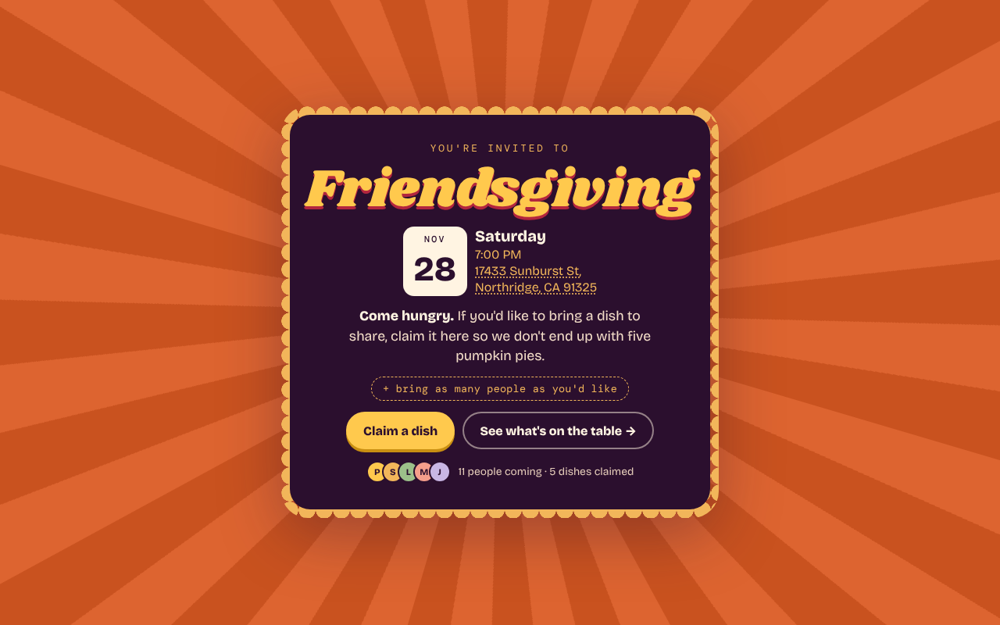
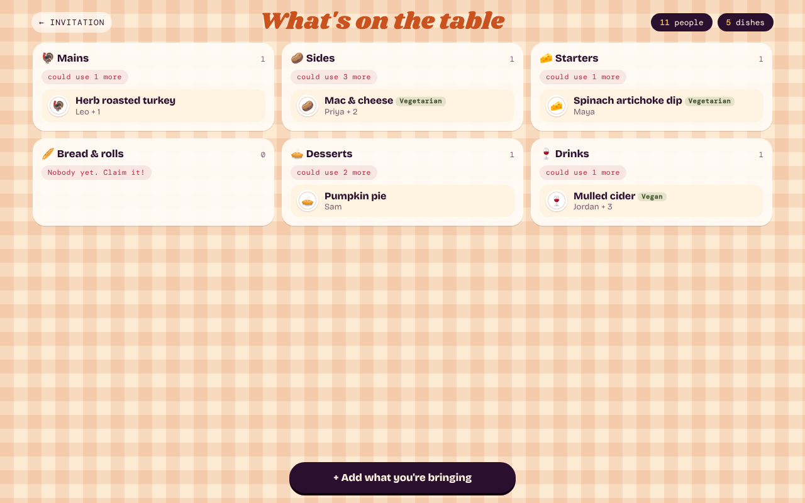
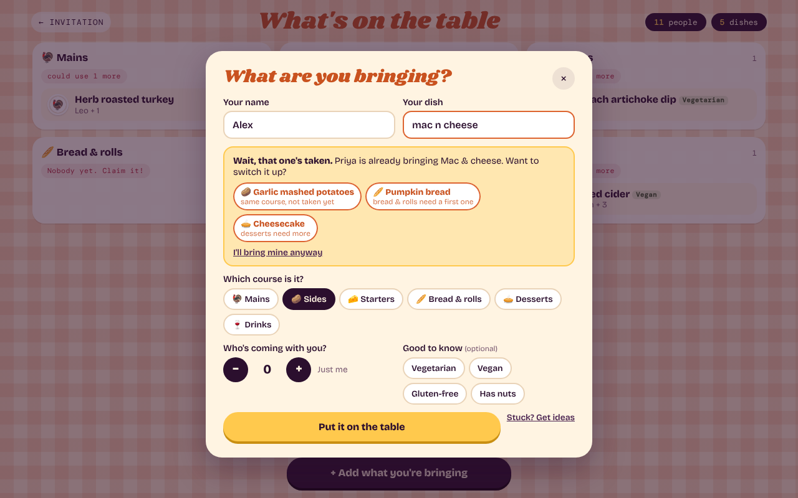
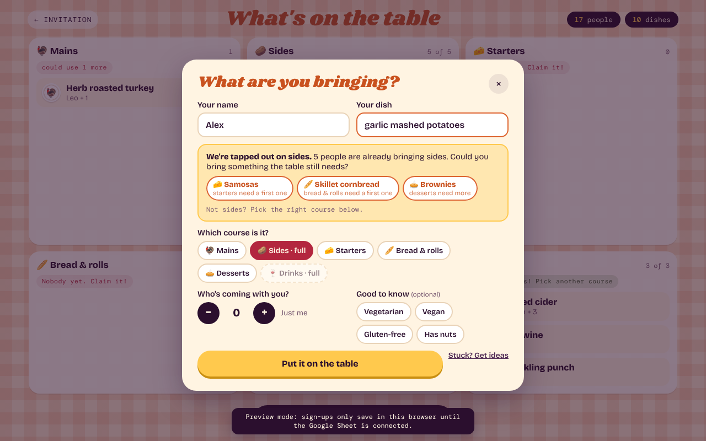

# Friendsgiving

A one-page invite for Friendsgiving on **Saturday, November 28**, plus a live board of who's bringing what.

- **Invitation** (`index.html`): fits one screen with no scrolling. Guests tap **Claim a dish** or **See what's on the table**.
- **The table** (`index.html#table`): everyone's dishes grouped by course, with a running headcount and the courses that still need something.
- **Doubles check:** if someone types a dish that's already claimed ("mac n cheese" vs "Mac & Cheese", "pumpkin pies" vs "Pumpkin pie"), they get a heads-up with ideas for what the table still needs. Claude can suggest those ideas if you add your API key. They can still bring theirs anyway.
- **Course limits:** once a course hits its limit (5 sides and 3 drinks by default), it's marked full on the board and the form, and anyone trying to add one is pointed to the courses that still need food. You also get a "Sides are now full" line in the email that fills it.
- **Bring as many people as you'd like:** each guest adds how many people they're bringing, and the headcount updates.
- **Email:** every sign-up sends an email to the host with the dish and the full current list.

| Invitation | The table | Doubles check |
|---|---|---|
|  |  |  |



(Screenshots use made-up sample names.)

## Setup (about 10 minutes)

The page is static. Sign-ups are stored in a Google Sheet you own, and a small Google Apps Script handles saving, emailing, and the Claude ideas. Guests don't need an account.

### 1. Create the sheet and the script

1. Create a new Google Sheet (sheets.new) while signed in to the Google account that should send the emails. Name it something like *Friendsgiving potluck*.
2. In the sheet, open **Extensions → Apps Script**.
3. Delete the starter code, then paste in everything from [`apps-script/Code.gs`](apps-script/Code.gs). Save.
4. In the function dropdown at the top, pick **setup** and press **Run**. Google asks for permission (the app needs to edit your sheet and send email as you). Allow it. You should get a "sign-ups are connected" email.

### 2. (Optional) Add your Claude API key for smarter ideas

1. In Apps Script, open **Project Settings** (gear icon) → **Script Properties** → **Add script property**.
2. Property: `ANTHROPIC_API_KEY`. Value: your key from console.anthropic.com.

The key stays on Google's servers and is never sent to guests' browsers. Without a key, the page uses its built-in list of ideas instead. Idea requests are capped at about 60 per 10 minutes so a shared link can't run up your bill.

### 3. Publish the script as a web app

1. Click **Deploy → New deployment**, choose type **Web app**.
2. **Execute as:** Me. **Who has access:** Anyone.
3. Click **Deploy** and copy the **Web app URL** (it ends in `/exec`).

### 4. Connect the page

Open `index.html`, find the `CONFIG` block near the bottom, and fill it in:

```js
const CONFIG = {
  apiUrl: "https://script.google.com/macros/s/XXXX/exec",  // from step 3
  weekday: "Saturday",
  time: "7:00 PM",
  place: "17433 Sunburst St, Northridge, CA 91325", // tapping it opens Google Maps
  limits: { main: null, side: 5, app: null, bread: null, dessert: null, drinks: 3 },  // most dishes per course; null = no limit
};
```

Until `apiUrl` is set, the page runs in **preview mode**: sign-ups only save in your own browser, and a small banner says so.

### 5. Put it online

Pick one:

- **GitHub Pages** (if this repo is public): repo **Settings → Pages → Deploy from a branch**, then pick the branch and `/ (root)`. Your link will be `https://<your-username>.github.io/Friendsgiving/`.
- **Netlify Drop** (works for private repos too): drag the folder onto app.netlify.com/drop.

Send friends the link. To send people straight to the board, add `#table` to the end. To open the add form, use `#add`.

## Running it

- **Edit or remove a sign-up:** edit the row in the Google Sheet. The page picks up changes within about 20 seconds.
- **Change course limits:** edit `limits` in the `CONFIG` block of `index.html`. No need to touch the script.
- **Change the notification email:** edit `HOST_EMAIL` at the top of `Code.gs`. After any change to the script, use **Deploy → Manage deployments → Edit → New version** so the live link uses it.
- **Add your invite link to the emails:** set `SITE_URL` in `Code.gs`.
